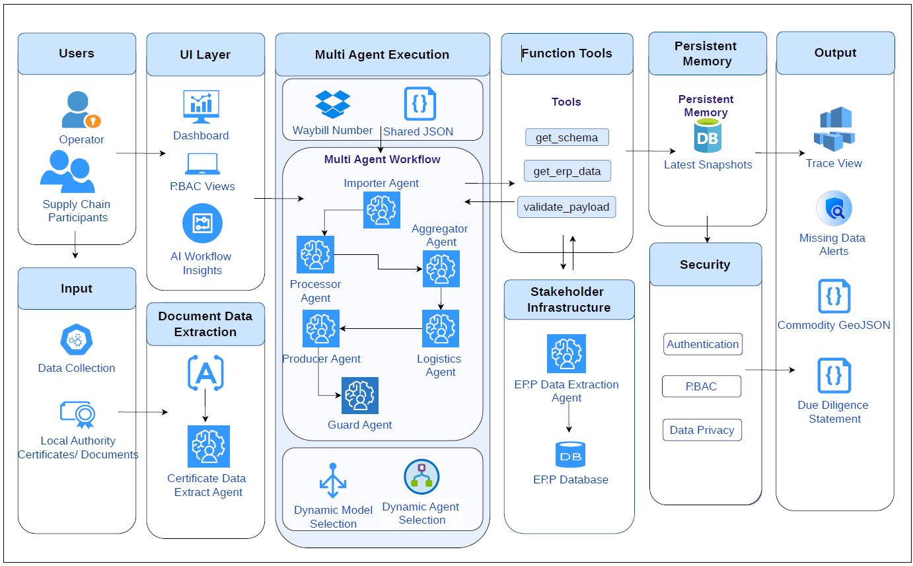
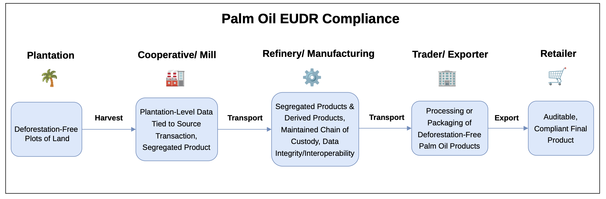

Few months ago, I completed my master’s thesis, “Exploring the Potential of Multi-Agent AI Systems for EUDR Compliance” where I explored how Multi-Agent AI Systems could support ecosystemic data exchange across multi-tier supply chains to support compliance with the European Union Deforestation Regulation (EUDR).

The work brought together supply-chain traceability, ecosystemic data, interoperability, autonomous AI agents, and multi-agent systems.

Here is a closer look at what I explored, what I built, and what the evaluation results showed.

## EUDR Compliance

The EUDR introduces mandatory traceability requirements for certain commodities placed on the EU market, with the objective of ensuring that products are deforestation-free and legally produced. A key part of the regulation is the due diligence, where the operators need to gather information about the products and their origin, including the country of production and the geolocation of the land where commodities were produced. The production activities must also comply with relevant laws and regulations in the producing country.

This creates a significant data requirement across the supply chain. A supply chain can involve many producers, aggregators, processors, logistics providers, exporters and importers. Information required for compliance is therefore distributed across multiple tiers and stakeholders.

The thesis identified that effective EUDR compliance requires different types of ecosystemic data across the supply chain, including: stakeholder identification data, geospatial and land-use data, production and environmental data, supply-chain transaction and logistics data, and legal and compliance-related data. These data collectively provide the basis for traceability and due-diligence processes. The challenge is therefore not simply collecting individual pieces of information. The information also needs to be exchanged and integrated across different supply-chain participants.

## Why interoperability and traceability matter

Supply chains are distributed environments by nature and different organizations can use different systems, data formats and technologies to store information. There are several challenges affecting the data exchange and traceability, including: fragmented data systems, lack of standardization, limited visibility beyond first-tier suppliers, different technological capabilities among stakeholders, manual data-processing activities, and concerns around sharing commercially sensitive information.

These challenges make it difficult to achieve end-to-end traceability across multiple supply-chain tiers. The thesis therefore focused on a key research question:

<em>How can Multi-Agent AI Systems contribute to interoperable and traceable ecosystemic data exchange among supply-chain stakeholders?</em>

## From supply chain actors to AI agents

A Multi-Agent System consists of several agents performing tasks according to defined roles and responsibilities. Multi-Agent Systems are particularly well suited to supply chains, which operate as distributed networks of independent business entities.

The proposed approach therefore represents different supply-chain stages through specialized agents. The reference architecture includes: Producer Agent, Aggregator Agent, Processor Agent, Logistics Agent, Importer Agent, ERP Data Extraction Agent, Document Data Extraction Agent and a Guard Agent. The agents participate in a sequential multi-agent workflow, exchanging information through a shared and standardized JSON data structure.

## A unified data structure

One of the key design elements of the proposed architecture is the Unified Traceability Data Model. The purpose of the schema is to provide a common structure for the information exchanged across the supply chain. Instead of allowing every agent to work with a different representation of the data, the agents use this shared JSON schema. The model is designed to be populated incrementally as the product moves through its supply chain stages. Each agent contributes information relevant to its role, gradually enriching the dataset until it forms the final traceability result.

## Working with different types of data

The architecture was designed to work with both structured and unstructured data. For example, supply-chain information may already exist inside companies’ enterprise systems, while other information may be provided through documents such as certificates or local authority documents.

##### Document data extraction:

The Document Data Extraction Layer transforms unstructured documents into machine-readable information. The thesis describes the use of autonomous AI agents and OCR techniques to extract required information from supporting documents.

##### ERP data extraction:

For enterprise systems, the architecture introduces an ERP Data Extraction Agent. Rather than moving all enterprise data into a central system, the agent is designed to be deployed within the stakeholder’s own infrastructure. It retrieves only the required information locally and returns structured data according to the shared JSON schema. This approach is intended to support data ownership and confidentiality while enabling controlled data exchange.

## A real-world scenario: tracing palm oil from Indonesia to EU region

To see how the proposed system works in practice, I used a palm oil supply chain scenario in which palm oil is produced in Indonesia and exported to the European Union.

This supply chain consists of several stages. Oil palm is initially harvested by smallholder farmers or large plantations. At the aggregator stage, mills or collection centers consolidate the fresh fruit bunches and maintain records of the producers they receive them from. The processor then transforms the raw palm oil through procedures such as extraction and refining, while generating batch identifiers for the input batches. The logistics stage handles transportation and export, with identifiers such as waybill numbers used to track the shipment. Finally, the importer receives the shipment. In this scenario, the importer also acts as the operator responsible for performing the due-diligence checks required for EUDR compliance.

Palm oil products can start with information about its production locations and harvest, move to a mill where its source is recorded, and then continue through processing and logistics with new batch and shipment references. At the importer stage, these pieces of information can be brought together to provide the traceability view across the different stages.

##  Building the prototype

The thesis followed a Design Science Research methodology.

The research process consisted of problem exploration and knowledge acquisition, definition of solution objectives, design and development, demonstration and evaluation.

A literature review was used to identify ecosystemic data requirements and interoperability and traceability challenges. These findings were then used to define the objectives of the proposed architecture. A prototype was implemented for the proposed architecture to demonstrate the multi-agent workflow, document data extraction, use of multiple data sources, and custom tool invocation.

Key technologies used for the implementation were C#/.NET with the Microsoft Agent Framework, PostgreSQL for data storage and ReactJS for the frontend. The Microsoft Agent Framework was used to implement the multi-agent workflow, with agents representing different supply-chain stages and tools and executors supporting data retrieval, processing, and controlled workflow execution.

##  Evaluating the system

The evaluation focused on the core functional capabilities of the prototype rather than large-scale performance. The main objectives were to determine whether the system could trace the product flows across supply-chain stages, handle incomplete data, maintain data consistency, identify errors and broken traceability links and produce accurate agent outputs. 

Five scenarios were used:

| Scenario | Description |
|:---|:---|
| **S1 — Ideal** | Complete data and valid supply-chain links |
| **S2 — Missing Data** | Selected attributes removed |
| **S3 — Partial Traceability** | A disruption introduced at a later stage |
| **S4 — Minimal Data** | Only essential attributes retained |
| **S5 — Broken Traceability** | Supply-chain links deliberately broken |

The evaluation was performed using a palm-oil supply-chain dataset. A total of 235 records were selected from the original dataset to represent multiple mills, refineries and production regions for a single importer.

## What the results showed

Under the ideal scenario, where all required data and supply-chain relationships were available, the prototype achieved high traceability completeness, successfully tracing all 43 expected nodes. Data consistency also reached a high level, while the Guard Executor achieved a high validation score. The system successfully completed all 227 traceability tasks in the baseline scenario.

The evaluation also showed how the system behaved when information was incomplete. With missing or minimal data, the system was still able to maintain structural traceability when the relationships between supply-chain actors remained intact. However, reduced data completeness resulted in less informative traceability outputs. When relationships between supply-chain stages were broken, the system could no longer reconstruct the complete supply-chain path. Instead, it identified missing links and provided only partial traceability information.

## What I learnt from the research

The findings indicate that Multi-Agent AI Systems can support ecosystemic data exchange by coordinating activities across multiple supply-chain stages. The proposed architecture addresses this through the unified data structure, standardized data exchange, specialized agents, ERP and document data extraction, function-based tools, validation mechanisms, and decentralized data extraction.

## Limitations

The prototype is still at an early stage, and the system was developed and tested in a local environment. ERP integration was partially simulated, the evaluation used a pre-processed dataset, and the system was not evaluated with real end users. The prototype also does not independently verify compliance using external deforestation-detection mechanisms such as remote sensing or geospatial analysis.

Therefore, the results demonstrate that the feasibility and behaviour of the proposed approach is under experimental conditions. 

## Final thoughts

Looking back at the thesis, the main takeaway for me was that Multi-Agent AI Systems can provide an interesting way to approach the interoperability and traceability challenges involved in EUDR compliance.

Through this research, I designed a Multi-Agent System reference architecture, a unified data schema, and a functional prototype, and then evaluated the approach using different supply-chain scenarios. The results were encouraging. When the required data and relationships were available, the system was able to achieve end-to-end traceability. Even when some data was missing or traceability links were disrupted, the system could still provide partial traceability.

At the same time, the evaluation made one thing very clear: the quality and structure of the data matter. The AI agents can coordinate the process, but the quality of the final traceability result still depends heavily on the information available to the system. The thesis shows that multi-agent system is a promising direction worth exploring further and there is still work to be done before this approach can be used in real-world supply chains. But for me, this research was a valuable opportunity to explore how AI agents, supply-chain data, and regulatory requirements intersect.

